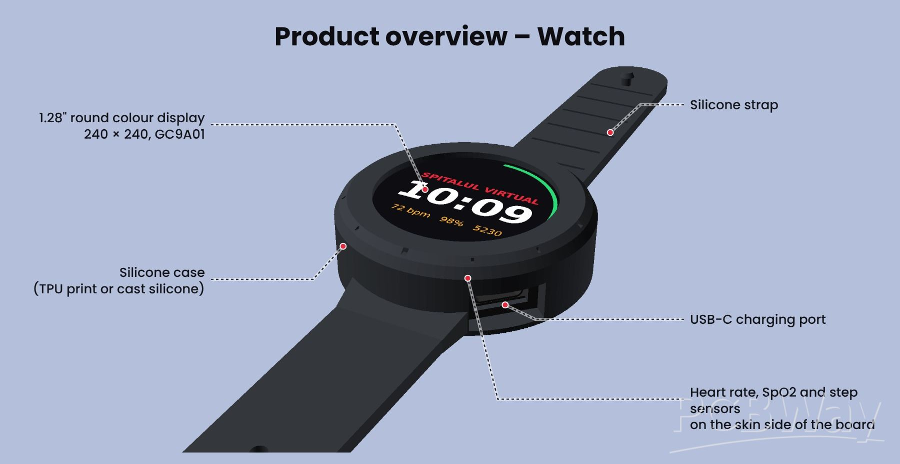
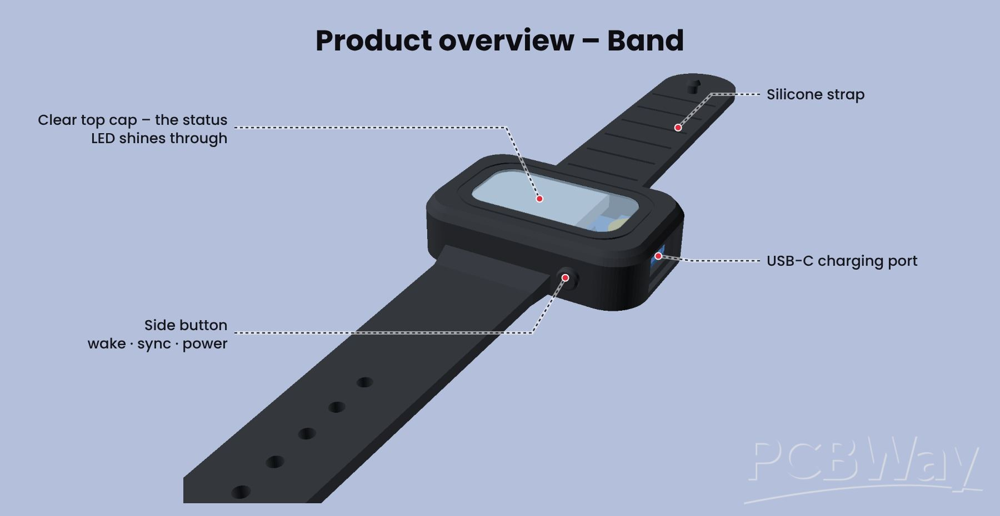

# Hi, I'm Nicola 👋

I'm a middle-school student at Colegiul Național „Mihai Viteazul" in Ploiești, Romania.
I love learning new things and getting better at them, and right now that means
building electronics that help people.

- 🔧 Working on [Spitalul Virtual](https://github.com/stancupatrick1/spitalul-virtual) with my team: improving our open-source health wearables (a smartwatch and a screenless band) and building the phone app that sends their data to a doctor
- 🇷🇴 Based in Ploiești, Romania · I write in English and Romanian

## 🛠️ Projects

### 🏥 Spitalul Virtual
A low-cost, open-source health smartwatch and screenless band, made for patients
who can't afford a commercial smartwatch.

> 🚧 **Status:** design finished, first prototypes coming soon.

  
    
  

- Custom black PCBs designed in KiCad, built around the ESP32-C3
- MAX30102 for heart rate & SpO2, TMP117 for skin temperature, LIS3DH for steps
- Stores ~45 days of data offline, syncs over Bluetooth LE
- Phone app sends the data to Health Connect → Spitalul Virtual platform → doctor
- Silicone case, USB-C charging, fully open hardware, firmware and software
